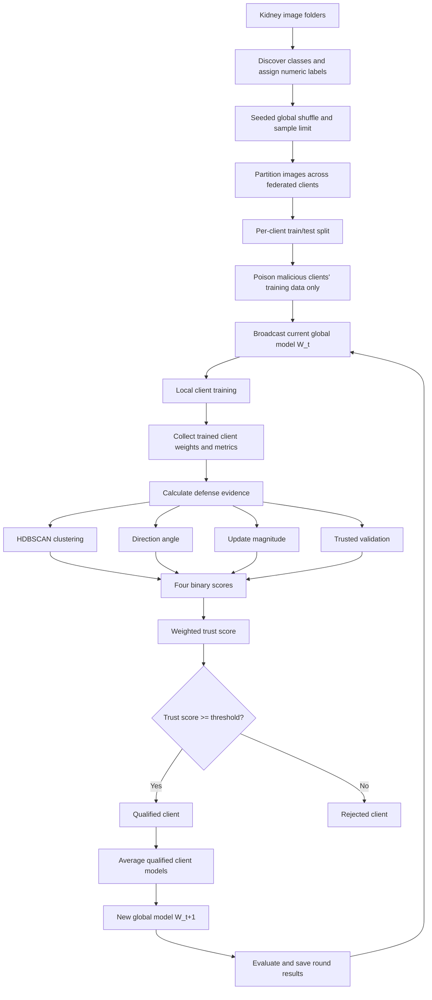

# Data and Project Process

This document explains how data moves through the federated-learning experiment,
how malicious clients are created, how clients are scored, and which output files
are produced. It describes the current implementation in `src/`.

## Project objective

The project trains a binary kidney-cancer image classifier with TensorFlow
Federated (TFF). During training, a configurable subset of clients is made
malicious through label-flipping or backdoor poisoning. Four defense checks are
combined into a trust score so that only qualified clients contribute to the
next global model.

## End-to-end flow



## 1. Input dataset

The configured dataset directory is:

```text
data/Kidney Cancer/
├── kidney_normal/
└── kidney_tumor/
```

Each child directory represents one class. Directory names are sorted and then
mapped to integer labels starting at zero. With the current folders, the mapping
is:

```text
kidney_normal -> 0
kidney_tumor  -> 1
```

Current local inventory:

| Class directory | JPG images |
| --- | ---: |
| `kidney_normal` | 5,000 |
| `kidney_tumor` | 5,000 |
| **Total** | **10,000** |

The model has a two-unit softmax output, so the current implementation expects
exactly two classes.

## 2. Loading and preprocessing

`prepare_client_dataset()` in `src/data_ops/client_partition.py` performs the
following operations:

1. Finds all class directories and image paths.
2. Assigns labels from the sorted class-directory names.
3. Shuffles the combined image/label list using the configured seed.
4. Limits the run to `MAX_SAMPLES` when a limit is configured.
5. Divides the shuffled records into approximately equal contiguous partitions,
   one for each client.
6. Loads each image as RGB, resizes it first to `224 x 224` and then to the
   model input size of `64 x 64`.
7. Converts pixels to `float32` and scales them to the range `[0, 1]`.
8. Creates a seeded train/test split independently for each client.
9. Applies attacks only to malicious clients' training split.
10. Creates shuffled, batched `tf.data.Dataset` training data and clean batched
    test data.

The clean test split is never poisoned. The current test fraction and batch size
come from `src/config/constants.py`.

## 3. Malicious-client assignment

`assign_fake_clients()` in `src/data_ops/attacks.py` creates client identifiers
from `client_0` through `client_N`. The head client, `client_0`, is excluded from
malicious selection. Other malicious clients are sampled reproducibly using
`SEED`.

The number of malicious clients is restricted by:

- the configured requested count;
- the number of available non-head clients; and
- the maximum fake-client ratio of 70%.

The attack distribution is currently 60% label-flip and 40% backdoor, with
integer counts assigned as closely as possible to that ratio.

### Label-flip attack

For the selected fraction of training labels:

- a different class label is sampled;
- the image is unchanged; and
- the configured default flip probability is `0.4`.

### Backdoor attack

For the selected fraction of training samples:

- a bright square trigger is written in the bottom-right corner;
- the label is changed to the configured target class (`0` by default); and
- the configured default poisoning probability is `0.4`.

## 4. Model and local federated training

The CNN in `src/models/cnn.py` contains three convolution/max-pooling blocks,
a 128-unit dense layer, and a two-class softmax output.

At the start of every round, the server broadcasts the current global weights
`W_t` to every client. Each client:

1. starts from the same `W_t`;
2. trains locally over its training dataset with SGDM;
3. returns its trained weights;
4. returns loss sum, correct-prediction count, and example count.

The experiment runner receives all client models before deciding which clients
are allowed into aggregation.

## 5. Defense evidence

The defense uses four independent binary checks. `client_0` is the trusted head
client and serves as the reference for all four checks.

### 5.1 Standard client update

For magnitude and HDBSCAN, the client update is measured from the model sent at
the start of the round:

```text
delta_i = local_model_i - W_t
```

Every layer delta is flattened and concatenated into one vector.

### 5.2 Clustering score

The flattened standard updates are processed as follows:

1. stack all client vectors;
2. L2-normalize each original client update so the clustering evidence focuses
   on update direction without removing the common benign update;
3. apply PCA with two components, keeping density estimation stable for the
   15 clients in each round;
4. run HDBSCAN with Euclidean distance, `min_cluster_size=2`, and a cluster
   selection epsilon of `0.2` to merge very close density subclusters; and
5. allow one cluster when the round contains one coherent benign population.

The clustering score is `1` when a client belongs to the same HDBSCAN cluster
as `client_0`; a client in a different valid cluster receives `0`. A noise
client is compared with `client_0` in the same normalized-update PCA space and receives
`1` when its distance is at most `1.5`. If `client_0` is noise, this distance
rule is used for all clients. `client_0` always receives `1`.

### 5.3 Direction score

Direction reproduces the calculation used in
`src/notebooks/fakeclients_segregation.ipynb`. A direction-only reference model
is first created by equally averaging all trained client models for the current
round:

```text
all_client_mean = mean(local_model_0, ..., local_model_N)
direction_delta_i = local_model_i - all_client_mean
```

The angle between `client_0`'s direction delta and each client's direction delta
is then calculated with cosine similarity:

```text
cosine = dot(direction_delta_0, direction_delta_i)
         / (norm(direction_delta_0) * norm(direction_delta_i) + epsilon)

angle_degrees = degrees(arccos(clip(cosine, -1, 1)))
```

The directions output includes `client_0 -> client_0` as exactly `0` degrees.
A client receives direction score `1` when its angle is strictly below
`DIRECTION_THRESHOLD`; otherwise it receives `0`.

This direction-only centered delta does not replace the standard round-start
delta used by magnitude and HDBSCAN.

### 5.4 Magnitude score

Magnitude is the L2 norm of the standard client update:

```text
magnitude_i = norm(delta_i, 2)
```

The accepted interval is relative to `client_0`:

```text
lower = magnitude_0 * (1 - MAGNITUDE_THRESHOLD)
upper = magnitude_0 * (1 + MAGNITUDE_THRESHOLD)
```

With the current threshold of `0.25`, values from 75% through 125% of the head
client's magnitude receive score `1`; all other values receive `0`.

### 5.5 Validation score

Every trained client model is evaluated on `client_0`'s clean test dataset,
which currently acts as the trusted validation dataset. The minimum accepted
accuracy is:

```text
minimum_accuracy = client_0_accuracy - VALIDATION_ACCURACY_TOLERANCE
```

With a tolerance of `0.06`, a client can be at most six percentage points below
`client_0` and still receive validation score `1`.

For a stricter experimental design, a separate trusted validation partition
should eventually replace `client_0`'s test data so that validation and final
testing are independent.

## 6. Trust score and selection

Each defense component produces either `0` or `1`:

```text
C_i = clustering score
D_i = direction score
M_i = magnitude score
V_i = validation score
```

The final trust score is:

```text
T_i = w_c*C_i + w_d*D_i + w_m*M_i + w_v*V_i
```

All four weights are currently `0.25`, so possible trust values are `0.00`,
`0.25`, `0.50`, `0.75`, and `1.00`. The current trust threshold is `0.51`.
Consequently, a client needs at least three successful checks (`0.75`) to be
qualified; two checks (`0.50`) are not enough.

## 7. Aggregation and the next round

When trust filtering is enabled:

- only qualified client models are included;
- each qualified client has equal weight in the layer-by-layer average;
- training metrics are recomputed from the qualified clients' example counts;
- if no client qualifies, the previous global model is retained.

When trust filtering is disabled, all client models are equally averaged.

The resulting model becomes `W_t+1` and is broadcast at the beginning of the
next round.

## 8. Evaluation

After aggregation in every round, the new global model is evaluated on
`client_0`'s clean test dataset. The experiment records:

- selected-client training loss and accuracy;
- global-model test loss and accuracy; and
- the final global evaluation after the last round.

`src/evaluation/detection_metrics.py` also provides malicious-client detection
metrics (accuracy, precision, recall, F1, TPR, FPR, TP, TN, FP, and FN), although
the main experiment runner does not currently call this function.

## 9. Output files

Results are written to `src/results/`. Existing experiments are preserved by
adding `_2`, `_3`, and so on when a target filename already exists.

| Output prefix | Contents |
| --- | --- |
| `globalmodel_results_*` | Round training metrics and global-model test metrics |
| `magnitudes_*` | Raw standard-update magnitude for every client and round |
| `directions_*` | `client_0` angle to every client, including itself |
| `hdbscan_*` | Cluster label and membership probability |
| `validation_*` | Validation loss and accuracy for every client |
| `trust_scores_*` | Four binary component scores and final trust score |
| `selected_clients_*` | Clients qualified in each round |
| `hdbscan_*_plots/` | PCA/HDBSCAN visualization for each round |

Files are updated after every completed round with all results accumulated so
far. This provides partial results if a later round fails.

## 10. Main configuration

Experiment parameters are defined in `src/config/constants.py`. Important
settings include:

- number of clients and malicious clients;
- federated rounds;
- sample limit, split fraction, and batch size;
- learning rate and random seed;
- enabled attacks and poisoning probabilities;
- defense thresholds and trust weights;
- trust filtering on/off; and
- data and result directories.

Current configuration snapshot:

| Setting | Current value |
| --- | ---: |
| Clients | 15 |
| Malicious clients | 3 |
| Federated rounds | 30 |
| Maximum samples | 10,000 |
| Client test split | 0.12 |
| Batch size | 8 |
| Client learning rate | 0.01 |
| Label-flip probability | 0.40 |
| Backdoor poison probability | 0.40 |
| Direction threshold | 90 degrees |
| Magnitude threshold | 0.25 |
| Validation tolerance | 0.06 |
| Trust threshold | 0.51 |
| Trust filtering | Enabled |

Always record the configuration used for a dissertation experiment because the
filenames include only some settings, not every threshold and attack parameter.

## 11. Running the experiment

From the repository root, activate the project environment and run:

```bash
python -m src.experiments.run_tff
```

The runner prints the malicious-client mapping, per-round defense results,
trust decisions, selected clients, training/global metrics, saved output paths,
and a final selection summary. A cleanup step terminates remaining TFF worker
processes and clears the TensorFlow/Keras session when the run exits.

## 12. Key implementation files

| File | Responsibility |
| --- | --- |
| `src/config/constants.py` | Experiment and defense configuration |
| `src/data_ops/client_partition.py` | Image loading, preprocessing, partitioning, splits |
| `src/data_ops/attacks.py` | Malicious-client assignment and attacks |
| `src/models/cnn.py` | CNN architecture |
| `src/federated/tff_process.py` | TFF initialization and local client training |
| `src/defense/weight_utils.py` | Flattening and client-delta construction |
| `src/defense/clustering.py` | PCA and HDBSCAN defense |
| `src/defense/direction.py` | Vector normalization and head-client angles |
| `src/defense/magnitude.py` | L2 update magnitudes |
| `src/defense/validation.py` | Trusted-data model evaluation |
| `src/defense/trustscore.py` | Binary checks and combined trust score |
| `src/experiments/run_tff.py` | End-to-end orchestration, aggregation, and outputs |
| `src/evaluation/model_evaluation.py` | Global-model evaluation |
| `src/evaluation/detection_metrics.py` | Optional detection-quality metrics |


Changes made:

  - src/config/constants.py:81
      - Added HDBSCAN_PCA_COMPONENTS = 2.
      - Kept HDBSCAN_MIN_CLUSTER_SIZE = 2.
      - Increased the noise distance threshold from 0.5 to 1.5.

  - src/defense/clustering.py:17
      - HDBSCAN now operates in two PCA dimensions.
      - Added validation for the requested PCA dimensionality.
      - The stored features and plots now represent the complete clustering space instead of only the first two dimensions of a much larger space.

  - Updated the clustering explanation in README.md:162 and DATA_README.md:163.

  Why the earlier fix did not help: 0.5 in normalized Euclidean space allows only about 29° of separation, so almost every noise client still failed the distance check. A threshold of 1.5 permits approximately 97° while
  still rejecting points near the opposite direction.

  Regression checks passed for PCA shape, min_cluster_size=2, noise-distance decisions, compilation, and formatting. Magnitude, direction, validation, trust weighting, and aggregation were not changed. A new experiment run
  is required to measure the improved clustering results.
