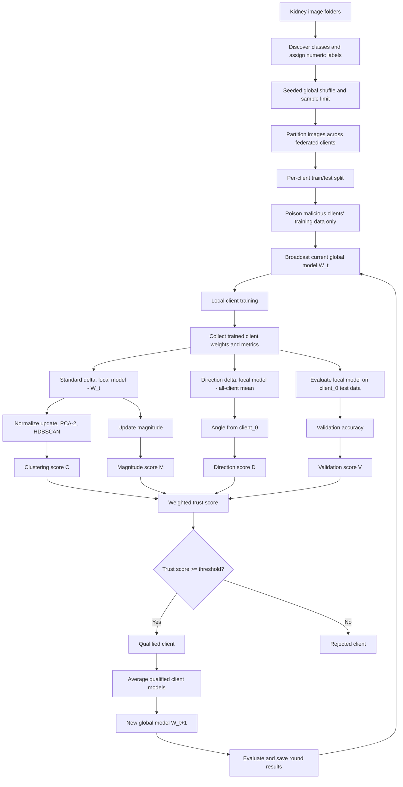

# Data and Project Process

This document explains how data moves through the federated-learning experiment,
how malicious clients are created, how clients are scored, and which output files
are produced. It describes the current implementation in `src/`.

## Project objective

The project trains a binary kidney-cancer image classifier with TensorFlow
Federated (TFF). During training, a configurable subset of clients is made
malicious through label-flipping or backdoor poisoning. Four defense checks are
combined into a trust score so that only qualified clients contribute to the
next global model.

## End-to-end flow



## 1. Input dataset

The configured dataset directory is:

```text
data/Kidney Cancer/
├── kidney_normal/
└── kidney_tumor/
```

Each child directory represents one class. Directory names are sorted and then
mapped to integer labels starting at zero. With the current folders, the mapping
is:

```text
kidney_normal -> 0
kidney_tumor  -> 1
```

Current local inventory:

| Class directory | JPG images |
| --- | ---: |
| `kidney_normal` | 5,000 |
| `kidney_tumor` | 5,000 |
| **Total** | **10,000** |

The model has a two-unit softmax output, so the current implementation expects
exactly two classes.

## 2. Loading and preprocessing

`prepare_client_dataset()` in `src/data_ops/client_partition.py` performs the
following operations:

1. Finds all class directories and image paths.
2. Assigns labels from the sorted class-directory names.
3. Shuffles the combined image/label list using the configured seed.
4. Limits the run to `MAX_SAMPLES` when a limit is configured.
5. Divides the shuffled records into approximately equal contiguous partitions,
   one for each client.
6. Loads each image as RGB, resizes it first to `224 x 224` and then to the
   model input size of `64 x 64`.
7. Converts pixels to `float32` and scales them to the range `[0, 1]`.
8. Creates a seeded train/test split independently for each client.
9. Applies attacks only to malicious clients' training split.
10. Creates shuffled, batched `tf.data.Dataset` training data and clean batched
    test data.

The clean test split is never poisoned. The current test fraction and batch size
come from `src/config/constants.py`.

## 3. Malicious-client assignment

`assign_fake_clients()` in `src/data_ops/attacks.py` creates client identifiers
from `client_0` through `client_N`. The head client, `client_0`, is excluded from
malicious selection. Other malicious clients are sampled reproducibly using
`SEED`.

The number of malicious clients is restricted by:

- the configured requested count;
- the number of available non-head clients; and
- the maximum fake-client ratio of 70%.

The attack distribution is currently 60% label-flip and 40% backdoor, with
integer counts assigned as closely as possible to that ratio.

### Label-flip attack

For the selected fraction of training labels:

- a different class label is sampled;
- the image is unchanged; and
- the configured default flip probability is `0.4`.

### Backdoor attack

For the selected fraction of training samples:

- a bright square trigger is written in the bottom-right corner;
- the label is changed to the configured target class (`0` by default); and
- the configured default poisoning probability is `0.4`.

## 4. Model and local federated training

The CNN in `src/models/cnn.py` contains three convolution/max-pooling blocks,
a 128-unit dense layer, and a two-class softmax output.

At the start of every round, the server broadcasts the current global weights
`W_t` to every client. Each client:

1. starts from the same `W_t`;
2. trains locally over its training dataset with SGDM;
3. returns its trained weights;
4. returns loss sum, correct-prediction count, and example count.

The experiment runner receives all client models before deciding which clients
are allowed into aggregation.

### 4.1 Exact processing order in each round

For round `t`, the runner performs the following sequence:

1. Save the current server model as `W_t`.
2. Send `W_t` and the corresponding local dataset to every client.
3. Train all client models locally and collect their trained weights and
   training statistics.
4. Calculate the standard update `local_model_i - W_t` for magnitude and
   clustering.
5. Equally average all trained client models to create the direction-only
   reference model.
6. Calculate direction deltas from that all-client mean and measure only the
   angles from `client_0`.
7. Run HDBSCAN on the standard updates.
8. Evaluate every trained client model on `client_0`'s clean test data.
9. Convert clustering, direction, magnitude, and validation evidence into four
   binary scores.
10. Calculate each client's weighted trust score and select clients whose score
    is greater than or equal to `TRUST_THRESHOLD`.
11. Equally average the selected client models. If none qualify, retain `W_t`.
12. Evaluate the resulting global model, write the accumulated Excel files,
    and regenerate the accumulated HDBSCAN plots.
13. Use the resulting global model as `W_t+1` for the next round.

## 5. Defense evidence

The defense uses four independent binary checks. `client_0` is the trusted head
client and serves as the reference for all four checks.

### 5.1 Standard client update

For magnitude and HDBSCAN, the client update is measured from the model sent at
the start of the round:

```text
delta_i = local_model_i - W_t
```

Every layer delta is flattened and concatenated into one vector.

### 5.2 Clustering score

The flattened standard updates are processed as follows:

1. stack all client vectors;
2. L2-normalize each original client update so the clustering evidence focuses
   on update direction without removing the common benign update;
3. apply PCA with two components, keeping density estimation stable for the
   15 clients in each round;
4. run HDBSCAN with Euclidean distance, `min_cluster_size=2`, and a cluster
   selection epsilon of `0.2` to merge very close density subclusters; and
5. allow one cluster when the round contains one coherent benign population.

In compact form, the clustering feature for client `i` is:

```text
unit_delta_i = delta_i / (norm(delta_i, 2) + epsilon)
z_i = PCA_2(unit_delta_i)
```

HDBSCAN and the noise-distance check both operate on `z_i`. The saved PCA plot
therefore shows the same feature space used to make the clustering decision.
The earlier post-PCA normalization is no longer used because it projected the
centered points around a unit circle and split small benign populations into
many artificial two-client clusters.

The clustering-score decision is:

1. `client_0` always receives clustering score `1`.
2. If `client_0` has a valid label and another client has the same label, that
   client receives `1`.
3. If both clients have valid but different labels, the other client receives
   `0`.
4. If the other client is noise (`-1`), its Euclidean distance to `client_0` is
   calculated in the PCA space. It receives `1` when the distance is at most
   `1.5`, otherwise `0`.
5. If `client_0` is noise, the same distance-to-head rule is applied to every
   other client in that round, regardless of its HDBSCAN label.

Raw HDBSCAN labels and membership probabilities are retained in the results;
the distance rule changes only the binary clustering score assigned to noise.

#### Why the latest clustering preprocessing changed

The earlier implementation centered and standardized every model parameter
across only 15 clients, applied PCA, and then L2-normalized the PCA coordinates.
This removed the common update shared by benign clients and placed the remaining
deviations around a unit circle. With `min_cluster_size=2`, HDBSCAN frequently
treated pairs of benign clients as separate valid clusters.

In the last completed clean run before the latest preprocessing correction,
noise had already fallen to an average of `0.8` clients per round, but HDBSCAN
still produced an average of `5` valid clusters and only `3.9` clients per round
shared `client_0`'s clustering score. This showed that cluster fragmentation—not
only noise—was the remaining problem.

The current implementation addresses that problem by:

- preserving the common update before dimensionality reduction;
- normalizing each complete client update instead of each parameter across
  clients;
- clustering directly in the two-dimensional PCA space shown in the plots;
- merging nearby density subclusters with `cluster_selection_epsilon=0.2`; and
- allowing a single valid cluster in a homogeneous clean round.

These settings must be assessed using a new complete clean run followed by runs
with different malicious-client counts. Results produced before this change do
not measure the current clustering pipeline.

### 5.3 Direction score

Direction reproduces the calculation used in
`src/notebooks/fakeclients_segregation.ipynb`. A direction-only reference model
is first created by equally averaging all trained client models for the current
round:

```text
all_client_mean = mean(local_model_0, ..., local_model_N)
direction_delta_i = local_model_i - all_client_mean
```

The angle between `client_0`'s direction delta and each client's direction delta
is then calculated with cosine similarity:

```text
cosine = dot(direction_delta_0, direction_delta_i)
         / (norm(direction_delta_0) * norm(direction_delta_i) + epsilon)

angle_degrees = degrees(arccos(clip(cosine, -1, 1)))
```

The directions output includes `client_0 -> client_0` as exactly `0` degrees.
A client receives direction score `1` when its angle is strictly below
`DIRECTION_THRESHOLD`; otherwise it receives `0`.

This direction-only centered delta does not replace the standard round-start
delta used by magnitude and HDBSCAN.

Only `client_0`-to-client angles are calculated and saved. The direction file
contains `client_0 -> client_0` with exactly `0` degrees, followed by
`client_0 -> client_1`, `client_0 -> client_2`, and so on. It does not contain
all possible client-to-client pairs.

### 5.4 Magnitude score

Magnitude is the L2 norm of the standard client update:

```text
magnitude_i = norm(delta_i, 2)
```

The accepted interval is relative to `client_0`:

```text
lower = magnitude_0 * (1 - MAGNITUDE_THRESHOLD)
upper = magnitude_0 * (1 + MAGNITUDE_THRESHOLD)
```

With the current threshold of `0.25`, values from 75% through 125% of the head
client's magnitude receive score `1`; all other values receive `0`.

The magnitude reference is deliberately `W_t`, not the all-client mean. Using
the all-client mean would make magnitude depend on the current client population
and could pull malicious residual magnitudes closer to the trusted client's
magnitude in later rounds.

### 5.5 Validation score

Every trained client model is evaluated on `client_0`'s clean test dataset,
which currently acts as the trusted validation dataset. The minimum accepted
accuracy is:

```text
minimum_accuracy = client_0_accuracy - VALIDATION_ACCURACY_TOLERANCE
```

With a tolerance of `0.06`, a client can be at most six percentage points below
`client_0` and still receive validation score `1`.

For a stricter experimental design, a separate trusted validation partition
should eventually replace `client_0`'s test data so that validation and final
testing are independent.

## 6. Trust score and selection

Each defense component produces either `0` or `1`:

```text
C_i = clustering score
D_i = direction score
M_i = magnitude score
V_i = validation score
```

The final trust score is:

```text
T_i = w_c*C_i + w_d*D_i + w_m*M_i + w_v*V_i
```

All four weights are currently `0.25`, so possible trust values are `0.00`,
`0.25`, `0.50`, `0.75`, and `1.00`. Selection uses an inclusive comparison:

```text
qualified_i = T_i >= TRUST_THRESHOLD
```

The current threshold is `0.50`; consequently, two or more successful checks
qualify a client. Increase the threshold above `0.50` if an experiment should
require at least three successful checks.

The complete binary decision rules are:

| Component | Score `1` | Score `0` |
| --- | --- | --- |
| Clustering `C_i` | Same valid cluster as `client_0`, or an applicable noise-distance result at most `1.5` | Different valid cluster, or applicable noise distance above `1.5` |
| Direction `D_i` | Angle from `client_0` is strictly below `90°` | Angle is `90°` or greater |
| Magnitude `M_i` | Magnitude is within the inclusive range `75%–125%` of `client_0` | Magnitude is outside that range |
| Validation `V_i` | Accuracy is at least `client_0_accuracy - 0.06` | Accuracy is below that value |

Because every check compares `client_0` with itself, `client_0` receives all
four component scores and a trust score of `1.0`.

## 7. Aggregation and the next round

When trust filtering is enabled:

- only qualified client models are included;
- each qualified client has equal weight in the layer-by-layer average;
- training metrics are recomputed from the qualified clients' example counts;
- if no client qualifies, the previous global model is retained.

When trust filtering is disabled, all client models are equally averaged.

The resulting model becomes `W_t+1` and is broadcast at the beginning of the
next round.

## 8. Evaluation

After aggregation in every round, the new global model is evaluated on
`client_0`'s clean test dataset. The experiment records:

- selected-client training loss and accuracy;
- global-model test loss and accuracy; and
- the final global evaluation after the last round.

`src/evaluation/detection_metrics.py` also provides malicious-client detection
metrics (accuracy, precision, recall, F1, TPR, FPR, TP, TN, FP, and FN), although
the main experiment runner does not currently call this function.

## 9. Output files

Results are written to `src/results/`. Existing experiments are preserved by
adding `_2`, `_3`, and so on when a target filename already exists.

| Output prefix | Contents |
| --- | --- |
| `globalmodel_results_*` | Round training metrics and global-model test metrics |
| `magnitudes_*` | Raw standard-update magnitude for every client and round |
| `directions_*` | `client_0` angle to every client, including itself |
| `hdbscan_*` | Cluster label and membership probability |
| `validation_*` | Validation loss and accuracy for every client |
| `trust_scores_*` | Four binary component scores and final trust score |
| `selected_clients_*` | Clients qualified in each round |
| `hdbscan_*_plots/` | PCA/HDBSCAN visualization for each round |

Files are updated after every completed round with all results accumulated so
far. This provides partial results if a later round fails.

### 9.1 How to interpret the clustering outputs

- A cluster label such as `0`, `1`, or `2` is only an identifier. The numeric
  value does not indicate trust or severity.
- Label `-1` means HDBSCAN noise. It does not automatically mean malicious.
- HDBSCAN probability describes confidence in the assigned raw cluster. It is
  retained for analysis but is not directly included in the current trust
  formula.
- The binary clustering score is the value that enters the trust score. It may
  differ from the implication of the raw label because noise points use the
  distance-to-head rule.
- In a clean run, repeated fragmentation into many two-client clusters indicates
  an overly sensitive clustering configuration.
- In a malicious run, useful separation means benign clients generally remain
  with `client_0`, while attacked clients form another cluster or exceed the
  configured noise-distance threshold.

For dissertation evaluation, compare at least the following across clean and
attacked experiments:

1. number of valid clusters per round;
2. number of noise clients per round;
3. number of clients receiving clustering score `1`;
4. benign clients incorrectly rejected;
5. malicious clients incorrectly accepted; and
6. final global-model accuracy and loss.

## 10. Main configuration

Experiment parameters are defined in `src/config/constants.py`. Important
settings include:

- number of clients and malicious clients;
- federated rounds;
- sample limit, split fraction, and batch size;
- learning rate and random seed;
- enabled attacks and poisoning probabilities;
- defense thresholds and trust weights;
- trust filtering on/off; and
- data and result directories.

Current configuration snapshot:

| Setting | Current value |
| --- | ---: |
| Clients | 15 |
| Malicious clients | 0 (current clean baseline) |
| Federated rounds | 30 |
| Maximum samples | 10,000 |
| Client test split | 0.12 |
| Batch size | 8 |
| Client learning rate | 0.01 |
| Label-flip probability | 0.40 |
| Backdoor poison probability | 0.40 |
| HDBSCAN PCA components | 2 |
| HDBSCAN minimum cluster size | 2 |
| HDBSCAN cluster-selection epsilon | 0.20 |
| HDBSCAN allows one cluster | Yes |
| HDBSCAN noise-distance threshold | 1.50 |
| Direction threshold | 90 degrees |
| Magnitude threshold | 0.25 |
| Validation tolerance | 0.06 |
| Trust threshold | 0.50 (inclusive) |
| Trust filtering | Enabled |

Although both attack implementations are enabled, `NUM_MALICIOUS=0` means the
current configuration assigns no client an attack. Change `NUM_MALICIOUS` for an
attacked experiment; `client_0` remains excluded from malicious assignment.

Always record the configuration used for a dissertation experiment because the
filenames include only some settings, not every threshold and attack parameter.

## 11. Running the experiment

From the repository root, activate the project environment and run:

```bash
python -m src.experiments.run_tff
```

The runner prints the malicious-client mapping, per-round defense results,
trust decisions, selected clients, training/global metrics, saved output paths,
and a final selection summary. A cleanup step terminates remaining TFF worker
processes and clears the TensorFlow/Keras session when the run exits.

## 12. Key implementation files

| File | Responsibility |
| --- | --- |
| `src/config/constants.py` | Experiment and defense configuration |
| `src/data_ops/client_partition.py` | Image loading, preprocessing, partitioning, splits |
| `src/data_ops/attacks.py` | Malicious-client assignment and attacks |
| `src/models/cnn.py` | CNN architecture |
| `src/federated/tff_process.py` | TFF initialization and local client training |
| `src/defense/weight_utils.py` | Flattening and client-delta construction |
| `src/defense/clustering.py` | PCA and HDBSCAN defense |
| `src/defense/direction.py` | Vector normalization and head-client angles |
| `src/defense/magnitude.py` | L2 update magnitudes |
| `src/defense/validation.py` | Trusted-data model evaluation |
| `src/defense/trustscore.py` | Binary checks and combined trust score |
| `src/experiments/run_tff.py` | End-to-end orchestration, aggregation, and outputs |
| `src/evaluation/model_evaluation.py` | Global-model evaluation |
| `src/evaluation/detection_metrics.py` | Optional detection-quality metrics |

## 13. Latest defense implementation summary

The current defense behavior includes these corrections:

1. **Magnitude reference correction:** magnitude uses the update from the
   round-start server model `W_t`, preventing the all-client mean from changing
   the magnitude reference.
2. **Notebook-compatible direction:** direction uses deltas from the post-local
   all-client mean and calculates the angle from `client_0` to every client,
   including the exact `client_0 -> client_0 = 0°` entry.
3. **Noise-aware clustering score:** a noise label does not automatically reject
   a client. Noise is resolved by distance to `client_0`, and a noisy
   `client_0` activates that distance rule for the whole round.
4. **Small-sample HDBSCAN space:** clustering uses L2-normalized complete client
   updates projected into two PCA components, instead of clustering in up to 14
   dimensions with only 15 clients.
5. **Fragmentation reduction:** HDBSCAN keeps `min_cluster_size=2`, merges close
   subclusters at epsilon `0.2`, and may return one coherent cluster.
6. **Unchanged trust integration:** all four scores remain binary and equally
   weighted; aggregation continues to use only clients meeting the inclusive
   trust threshold.

## 14. Important assumptions and limitations

- The defense assumes `client_0` is trusted. An attacked or unrepresentative
  head client would affect all four component decisions.
- The current trusted validation data is also `client_0`'s test data. A separate
  server-held validation dataset would provide stronger experimental isolation.
- PCA with two components improves density estimation for a 15-client round but
  discards some information from the full update vectors.
- HDBSCAN epsilon `0.2` and noise threshold `1.5` are experimental
  hyperparameters. They should be reported and evaluated across multiple attack
  counts rather than judged from a single run.
- With four equal weights and an inclusive threshold of `0.50`, two successful
  checks are sufficient for selection. This setting favors retaining clients;
  a threshold above `0.50` would require at least three checks.
- Cluster labels are recalculated independently in every round. Cluster `0` in
  one round is not necessarily related to cluster `0` in another round.
